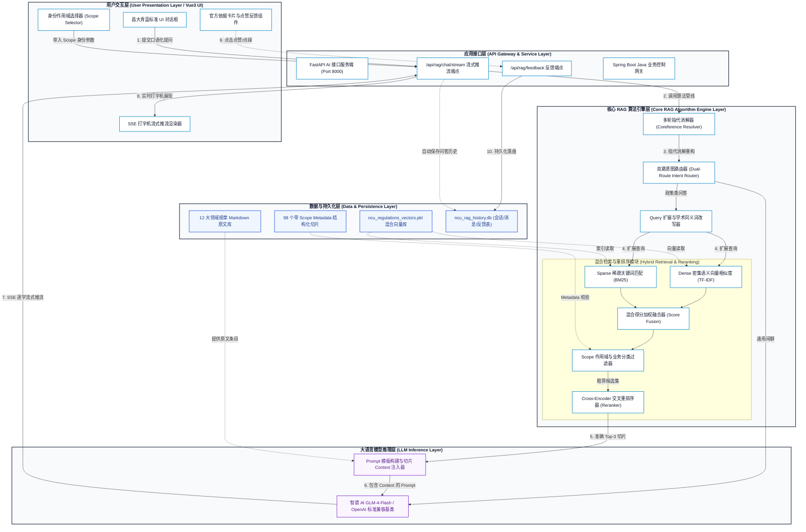

# 基于 RAG 的高校制度文档智能问答系统 - 系统总体架构图与设计说明

**论文题目**：基于 RAG 的高校制度文档智能问答系统  
**设计标准**：符合计算机科学与技术 / 软件工程专业毕业论文规范学术风格

---

## 一、 系统总体架构图 (Mermaid Academic Diagram)

---

## 二、 架构分层设计说明 (用于论文正文第三章)

### 1. 用户交互层 (User Presentation Layer)
- **多端适配 Vue3 对话界面**：遵循南昌大学 2022 版官方品牌 VI 规范（昌大青蓝 `#12368F` 与瓷白底色），支持跨设备浏览。
- **动态 Scope 作用域过滤器**：支持用户灵活切换【本科生】/【研究生】/【全校通用】三大权限作用域，从前端源头过滤非目标权限的制度文件。
- **SSE 逐字流式渲染器**：基于 JavaScript `ReadableStream` 与 `TextDecoder`，实现大模型输出的打字机光标（`▌`）实时动效。

### 2. 应用接口与控制层 (API Gateway Layer)
- **FastAPI 异步高并发服务**：运行于 `http://127.0.0.1:8000`，提供 `/api/rag/chat/stream`、`/api/rag/sessions` 和 `/api/rag/feedback` 端点。
- **流式响应控制器**：设置 `media_type="text/event-stream"` 和 `X-Accel-Buffering: no` 消息头，保障数据推流的低时延与零阻塞。

### 3. 核心 RAG 算法引擎层 (Core Algorithm Engine Layer)
- **双路意图路由器 (Dual-Route Router)**：通过正则表达式与关键词识别，自动将请求分流至【通用闲聊通道】或【可信校规 RAG 通道】。
- **多轮指代消解器 (Coreference Resolver)**：维护 `ConversationMemoryManager` 会话记忆，自动补全追问中的模糊代词（如“它”、“这个”），生成独立可检索问句。
- **Query 改写与扩展器 (Query Expansion)**：通过 12 大领域同义词字典将口语化提问标准化扩展（如“挂科” $\rightarrow$ “课程考核不及格 补考 重修”）。
- **混合检索与重排序器 (Hybrid Search & Cross-Reranker)**：
  - **Dense 向量**：TF-IDF 字符 2~4 gram 密集语义计算；
  - **Sparse 向量**：BM25 词频稀疏关键词提取；
  - **Score Fusion**：权重系数 $\alpha = 0.6$ 进行得分线性加权融合；
  - **Cross-Reranker**：对粗筛候选集实施二次交叉比对精排，输出 Top-3 精准切片。

### 4. 大语言模型推理层 (LLM Inference Layer)
- **Prompt 结构化注入**：将匹配出的制度名称、章节、条目及正文填入严格受限的系统 Prompt（System Prompt），要求“必须严格依据参考文档回答”。
- **智谱 AI GLM-4-Flash**：通过兼容 OpenAI SDK 的统一接口发起 API 流式推理，兼具极速响应与强逻辑总结能力。

### 5. 数据与持久化层 (Data & Persistence Layer)
- **规章 Markdown 语料库**：收录 12 大领域权威发文原文。
- **结构化切片库**：包含 98 个富集 `doc_title`, `chapter`, `article`, `student_type`, `category` 的 JSON 结构化切片。
- **SQLite 关系型数据库**：持久化存储 `chat_sessions`（会话表）、`chat_messages`（问答明细表）和 `user_feedbacks`（评分反馈表）。
